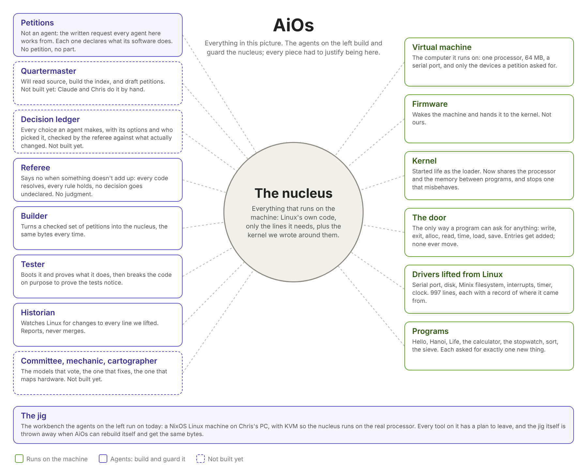

# AiOs

Pronounced AY-ohss.  Linux, re-admitted one justified line at a time.

## The series

The story of building it, told one part a day on LinkedIn.  The date is the day
each part goes up; the files are here before then, so read ahead if you like.
Each file holds the short post, the title and the full article.

| Part | Date | Title |
| --- | --- | --- |
| 1 | 2026-10-11 | [170 lines](posts/2026-10-11.html) |
| 2 | 2026-10-12 | [The rulebook](posts/2026-10-12.html) |
| 3 | 2026-10-13 | [Zero lines](posts/2026-10-13.html) |
| 4 | 2026-10-14 | [Ours and theirs](posts/2026-10-14.html) |
| 5 | 2026-10-15 | [The landlord learns what it owns](posts/2026-10-15.html) |
| 6 | 2026-10-16 | [The machine listens](posts/2026-10-16.html) |
| 7 | 2026-10-17 | [Definition of done](posts/2026-10-17.html) |
| 8 | 2026-10-18 | [Where's the kernel?](posts/2026-10-18.html) |
| 9 | 2026-10-19 | [The turbo button](posts/2026-10-19.html) |
| 10 | 2026-10-20 | [Saved like it's 1991](posts/2026-10-20.html) |
| 11 | 2026-10-21 | [From KERNAL to kernel](posts/2026-10-21.html) |
| 12 | 2026-10-22 | [Hi, I'm the other one](posts/2026-10-22.html) |
| 13 | 2026-10-23 | [Language matters](posts/2026-10-23.html) |

## Press play

No commands needed.  Click **Code → Codespaces → Create codespace** on this
page (or open the folder in VS Code with a WSL or Linux terminal), wait for it
to set itself up, press **F5**, pick a flavor.  You will see it build, boot,
print, and shut itself off.  Everything you see is explained below.

An operating system that contains only what someone asked for.  Nothing enters
without a petition that names its purpose, a spec that says what it must do, a
test that can prove it wrong, and a signed commit that admitted it.  Anything
nobody asks for anymore comes back out.  Linux is the parts bin, read and lifted
from one part at a time, never booted.

This repository is the constitution.  It is the only authority on what the
system contains and why.  The design is in [design.md](design.md); read it
first.  The plan is [plan/brief.md](plan/brief.md).  What went wrong and what
was decided is in [findings/](findings/).

## State

Petition 0000, hello world, boots: 170 lines across three parts, fourteen
bytes on the serial port and nothing else, the machine exits by itself.  57 of
those lines are lifted from Linux's serial driver; the rest are a loader that
runs one program and a program that only talks through the loader's system calls.
[findings/0002.md](findings/0002.md) lists every line no petition justifies.

Petition 0001, Towers of Hanoi, runs under the same loader binary with no
change to it.  Petition 0002, Conway's Game of Life, asks the loader for
memory: the loader grew by 35 lines and one system call, and the two earlier
programs run under it unchanged.  Petition 0003, a reverse-Polish calculator,
reads from the keyboard: the serial part we took from Linux gained its receive
side, the loader a read system call, and the three earlier programs run unchanged.  Petition 0004, a stopwatch,
counts seconds: the loader measures how fast the processor's counter ticks
against the old PC timer chip at boot, the way Linux does when nothing will
just tell it, and every earlier program runs unchanged under it.  Petition
0005 sorts twenty numbers and saves them: an IDE disk and the original Minix
filesystem, the one Linux started on in 1991, both lifted from Linux; the next
boot finds the file, and Linux's own fsck.minix finds the disk clean.
Petition 0006 runs two programs at once: the loader becomes a kernel, takes
the processor back a hundred times a second the way the Amiga did, and gives
each program its own memory; the stopwatch keeps time next to a program that
never lets go, and one that writes past its own memory is stopped alone.  The
ladder of petitions after that is in the plan: each one a program every CS
student wrote once, chosen because it needs exactly one new thing from the
machine.

Built and run so far under software emulation.  The jig (the build host) is
declared in [jig/](jig/) and not yet installed.  Nothing has been formally
admitted; every entry is still `draft`.

## Layout

    constitution/   tenets and purposes; the part no vote can amend
    schema/         the petition format, entry formats, signing
    petitions/      one TOML file per petition
    index/          CAP, PART, MACHINE and TOOL entries: what can be named, what exists
    specs/          SPEC clauses: as-intended behaviour, one testable sentence each
    tests/          TST entries: each bound to the clause it can turn red
    sensors/        SNS entries: question, threshold, consumer
    pool/           admitted source we wrote, one directory per component at a version
    lifted/         admitted source from upstream, each part with an origin record saying exactly where it came from
    flavors/        one TOML file per flavor: the set of petitions one machine runs
    findings/       what the schema or the plan could not express, and what was decided
    plan/           the project plan, brief and full
    jig/            the gen-zero build host, declared before it existed
    pi/             the bare repository that refuses unsigned pushes
    posts/          the series: each day a LinkedIn post and article in one HTML file, and its image

## Running a flavor

    sh jig/aios list
    sh jig/aios run hello

`aios` is the referee and the builder as one shell script until they are real
components: `check` resolves every catalogue number in the flavor's petitions and refuses
by rule number and code; `build` collects the components and compiles them;
`run` boots the result on the flavor's machine.  Needs gcc with 32-bit support
and qemu-system-x86_64.  In VS Code, Terminal > Run Task > "AiOS: run flavor".

## How this is made

Chris McLuckie decides and signs.  An AI (Claude) reads source, drafts entries,
and stages files; it never commits.  The rules that bind both are in
[CLAUDE.md](CLAUDE.md).  This GitHub repository is a mirror; the authority is a
bare repository that verifies every signature on push.

## Upstream

Nothing is merged from Linux.  Parts are lifted, with line-numbered provenance
in `origin.toml`, and watched:

    LINUX=/path/to/linux sh jig/upstream verify    # the records match upstream
    LINUX=/path/to/linux sh jig/upstream watch     # what upstream touched since

A change that matters is a new version of the part through the door.

## Licence

GPL-2.0-only, the same as Linux, which AiOs is built from.  Lifted source also
keeps its upstream notices.  See [LICENSE](LICENSE).
